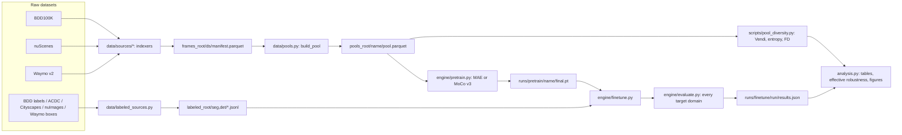

# Code architecture

## Package map (`src/xdssl`)

| module | responsibility |
|--------|----------------|
| `utils/config.py` | YAML loading with `_base_` inheritance, `key=value` CLI overrides, `${paths.*}` from `configs/paths.yaml` (or `$XDSSL_PATHS`) |
| `utils/misc.py` | seeding, autocast, LR schedule, JSON/JSONL I/O, logger |
| `data/schema.py` | unified frame-index columns and the weather / time-of-day vocabulary |
| `data/taxonomy.py` | Cityscapes-19 segmentation classes, harmonized 2-class detection, per-dataset label maps |
| `data/frames.py` | resize + save frames, incremental manifest writing |
| `data/sources/{bdd100k,nuscenes,waymo}.py` | raw layout -> frames + manifest |
| `data/pools.py` | pool specs -> exact-size samples (weights, filters, water-filled strata, exclusion ids) |
| `data/pretrain_dataset.py` | pool dataset, MAE / MoCo augmentations, temporal positive pairs |
| `data/labeled_sources.py` | annotated datasets -> unified JSONL records |
| `data/labeled_datasets.py` | Seg/Det torch datasets, deterministic label-fraction subsets |
| `data/synthetic.py` | procedurally generated stand-in data for tests |
| `models/vit.py` | ViT (timm-compatible weight names, on-the-fly position-embedding resampling) |
| `models/mae.py`, `models/moco.py` | SSL methods; both expose `.encoder` and `forward(batch) -> ({"loss"}, extras)` |
| `models/backbone.py` | init from random / ImageNet (timm) / SSL checkpoint; ViTDet-style 4-level pyramid |
| `models/segmentation.py` | Semantic-FPN head or linear probe |
| `models/detection.py` | torchvision Faster R-CNN on the pyramid |
| `engine/optim.py` | AdamW param groups with layer-wise LR decay |
| `engine/pretrain.py` | step-based SSL training with resume |
| `engine/finetune.py` | fine-tune -> save `model.pt` -> evaluate all domains -> `results.json` |
| `engine/evaluate.py` | mIoU (+ bootstrap CI) / COCO AP per domain |
| `metrics/` | segmentation, detection, robustness (relative, effective), diversity (entropy, Vendi, Fréchet) |
| `experiments.py` | expands experiment YAML into idempotent pool, pretrain and fine-tune jobs with deterministic names |
| `analysis.py` | collects `results.json` files into tables and figures |

## Key interfaces

**Frame manifest row** (`schema.FRAME_COLUMNS`): `frame_id, dataset, split, sequence_id, camera, timestamp,
path, weather, timeofday, location, scene_type`.

**Labeled record** (JSONL): `{"image", "mask"|"boxes"+"labels"+"width"+"height", "dataset", "attrs": {...}}`.
Evaluation domains are filters over `attrs`.

**Pretraining checkpoint** (`final.pt`): `{"encoder": state_dict, "encoder_config": VisionTransformer kwargs,
"method", "pool", "config"}`. This is all `build_backbone(init="ssl")` needs.

**Fine-tune output** (`results.json`): `{"meta": {...init, pool, label_fraction, seed, protocol...},
"domains": {name: metrics}, "summary": {id, mean_ood, worst_ood, relative_robustness}}`.

## Extension points

- **New unlabeled source:** write `data/sources/<name>.py` that saves frames and calls `write_manifest` with
  `FRAME_COLUMNS`, then add a sub-command to `scripts/prepare_frames.py`.
- **New SSL method:** create a module with `.encoder` (a `VisionTransformer`) and `forward(batch) -> ({"loss": t}, {})`,
  register it in `engine/pretrain.build_pretrain_model`, and add a config in `configs/pretrain/`.
- **New backbone family (e.g. ResNet / ConvNeXt):** must provide `depth`, `layer_id(name)`, `config`, and
  `forward_features(x, out_indices)` returning 4 maps. Then the pyramid's rescale layers need per-level strides.
- **New task head:** follow `SegmentationModel` / `DetectionModel`, expose `.backbone`, and add the task to
  `engine/finetune.build_task_model`, `_step_loss` and `evaluate_domains`.
- **New target domain:** a converter in `labeled_sources.py` plus one entry in `configs/eval/*.yaml`.
